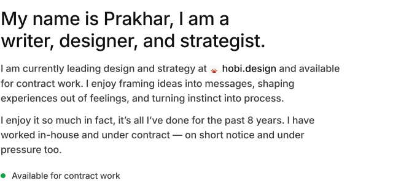
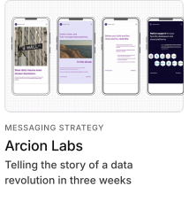
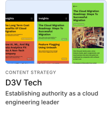
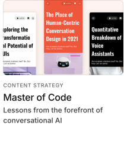
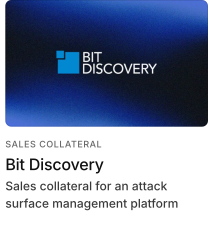
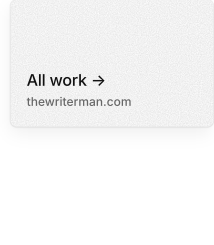

<a href="https://thewriterman.com"><picture><source media="(prefers-color-scheme: dark)" srcset="assets/masthead-dark.svg"></picture></a>

<a href="https://thewriterman.com/about"><picture><source media="(prefers-color-scheme: dark)" srcset="assets/intro-dark.svg"></picture></a>

<a href="https://thewriterman.com/work"><picture><source media="(prefers-color-scheme: dark)" srcset="assets/work-dark.svg"></picture></a>
<a href="https://thewriterman.com/projects/alliciante-jewels"><picture><source media="(prefers-color-scheme: dark)" srcset="assets/alliciante-jewels-dark.svg"></picture></a><a href="https://thewriterman.com/projects/arcion-labs"><picture><source media="(prefers-color-scheme: dark)" srcset="assets/arcion-labs-dark.svg"></picture></a><a href="https://thewriterman.com/projects/d3v-tech"><picture><source media="(prefers-color-scheme: dark)" srcset="assets/d3v-tech-dark.svg"></picture></a>
<a href="https://thewriterman.com/projects/managed-it-services"><picture><source media="(prefers-color-scheme: dark)" srcset="assets/managed-it-services-dark.svg"></picture></a><a href="https://thewriterman.com/projects/master-of-code"><picture><source media="(prefers-color-scheme: dark)" srcset="assets/master-of-code-dark.svg"></picture></a><a href="https://thewriterman.com/projects/smoky-mountain-cbd"><picture><source media="(prefers-color-scheme: dark)" srcset="assets/smoky-mountain-cbd-dark.svg"></picture></a>
<a href="https://www.hobi.design/work/evolv-technology"><picture><source media="(prefers-color-scheme: dark)" srcset="assets/evolv-technology-dark.svg"></picture></a><a href="https://www.hobi.design/work/bit-discovery-acquired-by-tenable"><picture><source media="(prefers-color-scheme: dark)" srcset="assets/bit-discovery-dark.svg"></picture></a><a href="https://thewriterman.com/work"><picture><source media="(prefers-color-scheme: dark)" srcset="assets/all-work-dark.svg"></picture></a>

<a href="https://thewriterman.com/contact"><picture><source media="(prefers-color-scheme: dark)" srcset="assets/contact-dark.svg"></picture></a>

[about](https://thewriterman.com/about) · [work](https://thewriterman.com/work) · [notes](https://thewriterman.com/notes) · [archive](https://thewriterman.com/archive) · [linkedin](https://www.linkedin.com/in/prakharrsingh/) · [email](mailto:hi@thewriterman.com)
